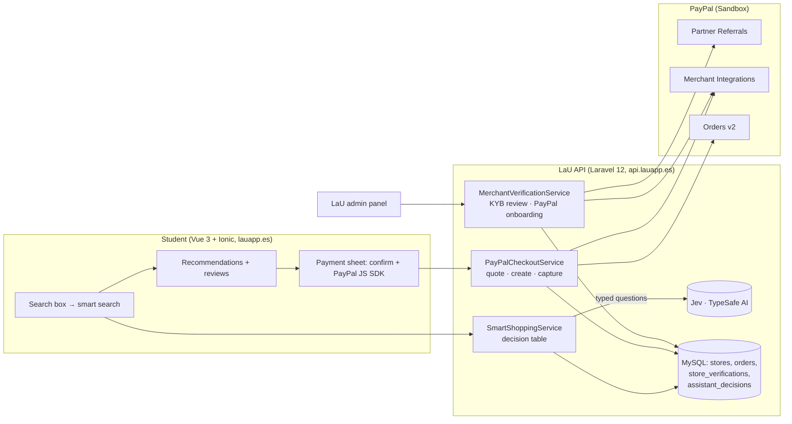

# LaU Marketplace: verified campus commerce with PayPal and AI-powered search

> Submission for **Build What's Next with PayPal and AI**.
>
> **Testing environment:** the app is hosted on our own infrastructure (`lauapp.es` and `api.lauapp.es`), but this Marketplace feature is in **pre-launch testing**. Every payment runs on **PayPal Sandbox**, so no real money moves. The UI is in **Spanish**, because our users are university students in El Salvador. A glossary of the key buttons is at the end of this file.

| | |
|---|---|
| Live app | https://lauapp.es (Marketplace: https://lauapp.es/tabs/marketplace) |
| Merchant landing page | https://lauapp.es/empresas |
| Frontend repository (Vue 3 + Ionic) | this repository |
| Backend repository (Laravel 12) | `LaU-app/LaUapi` (see `docs/paypal-marketplace.md`) |
| Test accounts | see [Test accounts](#test-accounts) (passwords are in the Devpost *testing instructions*) |

---

## The problem

LaU is a social network for university students in El Salvador. It brings a feed, profiles and chat, study tools (Pomodoro and tasks) and a student marketplace together in one app.

Students constantly need study supplies: calculators, lab coats, drafting kits, books. Small local businesses want to sell to them. Today those sales happen through informal channels, which leaves two gaps:

- students have no way to know whether a seller is trustworthy;
- businesses have no simple way to accept safe online payments from a student audience.

## What we built

1. **Verified merchants.** A business applies inside the app with its legal data: legal name, NIT (tax ID), NRC for companies, legal representative and a supporting document. The LaU team reviews the application in our admin panel and approves it, requests changes or suspends the business. Approval sends an email from LaU.
2. **PayPal onboarding for each merchant.** The approved merchant connects their PayPal Business account with **Partner Referrals**. LaU then asks PayPal for the seller status and treats PayPal as the source of truth. It checks that the account can receive payments, that the primary email is confirmed and that our platform has OAuth permissions. Only then does the store get the **"Verified by LaU · PayPal"** badge and accept online payments.
3. **AI-powered search.** The Marketplace search box understands needs, not just keywords. For example: *"calculadora científica para Cálculo II, máximo $20"* or *"algo para mis clases de matemáticas"*. A *Búsqueda inteligente* (smart search) section appears above the normal results. There, **Jev by TypeSafe AI**, a typed-decision model, evaluates **only real products from verified merchants**. Each pick shows:
   - a match score;
   - the **sentence from the product description that Jev selected as evidence**;
   - reasons computed in code (rank, budget, stock) and product facts;
   - **YouTube reviews that Jev confirmed are about that kind of product**, or a clear "no videos or reviews" message.

   The student always confirms explicitly before paying with PayPal.
4. **PayPal checkout to the right merchant.** The backend computes price and total and creates an **Orders v2** order with the merchant as `payee`. The student approves it with the **PayPal JS SDK**. The backend then verifies the order with PayPal and captures it. A paid LaU order exists only after PayPal confirms the capture as `COMPLETED`.
5. **After the sale.** The order shows as **"Pagado"** for both buyer and seller. The buyer can message the seller, and the product is quoted as a rich preview above the message.

## How we use PayPal

| PayPal capability | Where | Why |
|---|---|---|
| OAuth 2.0 `client_credentials` | `app/Services/PayPal/PayPalClient.php` | Platform access token, kept in memory only and never logged |
| **Partner Referrals API v2**: `POST /v2/customer/partner-referrals` | Merchant "Connect PayPal" | Onboard each verified merchant with a `tracking_id` and a `return_url` back to LaU |
| **Merchant Integrations**: `GET /v1/customer/partners/{partner}/merchant-integrations?tracking_id=` and `/{merchant_id}` | Seller status | Source of truth: `payments_receivable`, `primary_email_confirmed`, `oauth_integrations` with our client ID and the required scopes |
| **Orders API v2**: create, show and capture (`intent: CAPTURE`) | Checkout | `payee.merchant_id` = the merchant; `PayPal-Request-Id` idempotency for create and capture; amount, currency, payee and buyer validated before and after capture |
| **PayPal JavaScript SDK** (Buttons, `merchant-id`) | Payment sheet | Buyer approval in the official PayPal popup |

Safety rules:

- **Prices and totals.** Computed server-side in integer cents. The browser only sends a product ID and a quantity.
- **Duplicate captures.** Blocked three ways: a lock, a status check with PayPal and a unique index.
- **Pending captures.** A `PENDING` capture is never shown as paid.
- **Errors.** PayPal errors are sanitized: no tokens, secrets or full responses reach the API or the logs.

## How we use AI: Jev by TypeSafe AI

**Tool:** [Jev](https://typesafe.ai/), TypeSafe AI's *System One* decision model (`jev-latest`). We call it from Laravel's HTTP client at `POST https://api.typesafe.ai/v1/systemone`. Jev doesn't generate text. It answers typed questions (`noul` = probability that a statement is true, `choice`, `score`) with calibrated probabilities. That makes it a good fit for commerce: the AI makes judgments, and our code makes the decisions.

| Who | Responsibility |
|---|---|
| **Laravel** | Validates input, extracts money amounts from the text, loads **only active products from verified merchants that accept PayPal**, compares prices with the budget, computes totals and applies an explicit **decision table** |
| **Jev** | *Does the student want to buy something?* · *Do they say what item they need?* · *Do they say what it is for (a class, a project)?* · *Which category?* · *What does each amount in the message mean (max price, money to keep aside, other)?* · per real candidate: *Is this the kind of item asked for?* (noul), *How well does it cover the need?* (score 0–3), *How useful is it for the course?* (score 0–2) · *Which candidate fits best?* (choice) · *Which sentence of the real product description best shows it fits?* (choice; quoted to the student as evidence) · for reviews: *Is this YouTube video about this kind of product?* (noul per video) |
| **Student** | Picks a product, confirms the summary (merchant, product, price, total) and approves in PayPal |

Decision table, using conservative thresholds (≥ 0.7 counts as yes, ≤ 0.3 as no, and anything in between as unclear):

- `recommendation`: a candidate is what was asked for, covers the need and fits the budget.
- `over_budget`: matching candidates exist, but none fits the budget.
- `confirm_choice`: only uncertain matches; the student confirms.
- `needs_clarification`: the request names neither an item nor what it is for, so the search asks for details first.
- `not_a_purchase` and `no_match`.

What the AI **never** does:

- invent products, prices or stock;
- see prices or compute totals (the budget comparison is done in code);
- trigger a payment.

A failed AI call is an error, never a fallback answer. Every decision is stored with its probabilities and shown in the admin panel (*Compra inteligente*) for auditability.

**Tools used during development:** Claude Code (Anthropic) as a coding assistant.

## Architecture

## Test accounts

| Role | Where | Account |
|---|---|---|
| Student (buyer) | LaU, https://lauapp.es | `estudiante.demo@lauapp.es` |
| Merchant (seller, "Papelería Campus Central") | LaU, https://lauapp.es | `comercio.demo@lauapp.es` |
| PayPal buyer | PayPal Sandbox popup | `sb-g9x2153766254@personal.example.com` |

All passwords are in the Devpost **testing instructions** and are not published in this repository. PayPal Sandbox accounts hold only test money.

## How to test (about 5 minutes, two browsers)

Use **two browsers, or one normal window and one private window**, so you can be the buyer and the seller at the same time.

**Browser A: student**

1. Open https://lauapp.es → **Iniciar sesión** (log in) with the student account.
2. Go to **Marketplace** (shop icon in the bottom bar).
3. In the search box, type `calculadora científica para Cálculo II, máximo $20`. Press **Enter**, or the ✨ button inside the field.
4. The **Búsqueda inteligente** section appears above the normal results while the AI works. It recommends **"Calculadora científica 417 funciones"** and shows:
   - a match ring;
   - **"Por qué te lo recomiendo"** (why I recommend it): a sentence quoted from the product description, plus the reasons;
   - stock and the other product facts.
5. Open **Reseñas y videos** (reviews and videos). You'll see YouTube reviews the AI judged relevant, or a clear "no videos or reviews" message.
6. Tap **Comprar** (Buy). Review the summary (merchant, product, price, total), tick the confirmation box, and click the **PayPal** button.
7. In the PayPal popup, log in with the **PayPal Sandbox buyer** account and pay.
8. You get a receipt with a LaU order code. **Ver mis compras** shows the order as **"Pagado"** (paid).
9. Open the product again → tap the chat icon (**Escribir al vendedor**). The message comes pre-filled with the **product preview card** above it. Send it.

**Browser B: merchant**

1. Log in with the merchant account → **Marketplace** → **Mis ventas** (orders, *Ventas* tab). The new order appears as **Pagado**.
2. Open **Chat** to see the buyer's message with the product preview.
3. **Marketplace → ¿Tenés un comercio?** shows the verified status and the PayPal connection.

**Optional: onboard a brand-new merchant**

1. Create a new LaU account → **Marketplace → ¿Tenés un comercio?** → create a store → submit the legal form. For testing, any 14-digit NIT such as `0614-010190-101-3` and any PDF are fine.
2. The LaU team approves applications during judging. You'll receive an email and the app shows **"Conectar con PayPal"**.
3. Connect with any PayPal **Sandbox Business** account; you can create one at developer.paypal.com → Testing Tools → Sandbox Accounts. Back in LaU, tap **Ya terminé, verificar**: LaU asks PayPal for the seller status and enables payments.

## Run it locally

1. **Backend (`LaUapi`).** Follow `docs/paypal-marketplace.md`:
   1. `composer install && npm ci && npm run build`
   2. copy `.env.example` to `.env`, then set the `PAYPAL_*` and `TYPESAFE_API_KEY` variables
   3. `php artisan migrate`
   4. `php artisan db:seed --class=MarketplaceShowcaseSeeder`
   5. `php artisan paypal:link-store papeleria-campus-central <your sandbox tracking_id>`
   6. `php artisan marketplace:demo-accounts`
   7. `php artisan serve`
2. **Frontend (this repo).**
   1. `npm ci`
   2. create `.env.development.local` with `VITE_API_URL=http://127.0.0.1:8000/api` and `VITE_PAYPAL_CLIENT_ID=<your sandbox client ID>`
   3. `npm run dev`
3. **Tests.**
   - Backend: `php artisan test --filter='PayPal|SmartShopping|JevClient|MerchantVerification|MarketplaceShowcase'`. PayPal and TypeSafe are mocked with `Http::fake`; an optional live Jev test is included.
   - Frontend: `npx vitest run tests/unit/paypalCheckout.spec.ts`.

## Requirements checklist

| Requirement | How LaU meets it |
|---|---|
| Meaningful PayPal integration (Sandbox) | Partner Referrals onboarding, Merchant Integrations seller status, Orders v2 create/show/capture with payee, PayPal JS SDK, all on Sandbox |
| Meaningful AI | Jev (TypeSafe AI) drives the smart search's understanding, candidate evaluation and selection, with an auditable decision log |
| Working prototype | Hosted at lauapp.es; end-to-end purchase with real PayPal Sandbox payments |
| Documentation | This file, `docs/paypal-marketplace.md` (backend) and inline code docs |
| Tools disclosed | PayPal APIs and JS SDK; Jev by TypeSafe AI; Claude Code for development |
| Public repo + license | MIT license (see `LICENSE`) |
| Demo video | Pending (under 3 minutes, YouTube) |

## UI glossary (Spanish → English)

| UI | Meaning |
|---|---|
| Búsqueda inteligente | Smart (AI) search |
| Por qué te lo recomiendo | Why I recommend it |
| Reseñas y videos | Reviews and videos |
| Tu panel de ventas | Your seller dashboard |
| Comprar / Comprar con PayPal | Buy / Buy with PayPal |
| Confirmo que quiero comprar… | I confirm I want to buy… |
| Pagado | Paid |
| Mis compras / Mis ventas | My purchases / My sales |
| ¿Tenés un comercio? | Do you have a business? |
| Verificado por LaU | Verified by LaU |
| Conectar con PayPal | Connect with PayPal |
| Ya terminé, verificar | I'm done, verify |
